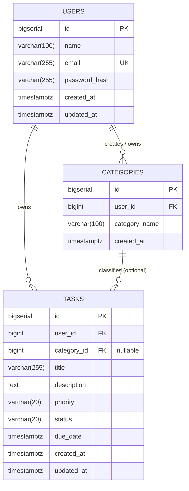

# TaskFlow Database Design Documentation

## 1. Overview
The TaskFlow database is designed to support a collaborative task management application. Built on PostgreSQL, the relational schema models user accounts, custom categories, and assigned tasks with full referential integrity, domain constraints, and query-optimized indexes.

---

## 2. Entity-Relationship Diagram (ERD)

---

## 3. Data Dictionary

### 3.1. `users` Table
Stores authenticated account credentials and profile metadata.

| Column | Data Type | Constraints | Default | Description |
|---|---|---|---|---|
| `id` | `BIGSERIAL` | `PRIMARY KEY` | Auto-incrementing sequence | Unique identifier for each user |
| `name` | `VARCHAR(100)` | `NOT NULL` | None | Full display name of the user |
| `email` | `VARCHAR(255)` | `NOT NULL`, `UNIQUE` | None | User email address used for login and notifications |
| `password_hash` | `VARCHAR(255)` | `NOT NULL` | None | Securely hashed password (e.g., bcrypt/argon2) |
| `created_at` | `TIMESTAMPTZ` | `NOT NULL` | `CURRENT_TIMESTAMP` | Timestamp when the user account was created |
| `updated_at` | `TIMESTAMPTZ` | `NOT NULL` | `CURRENT_TIMESTAMP` | Timestamp when the user account was last modified |

---

### 3.2. `categories` Table
Allows users to organize tasks into personalized groups or projects.

| Column | Data Type | Constraints | Default | Description |
|---|---|---|---|---|
| `id` | `BIGSERIAL` | `PRIMARY KEY` | Auto-incrementing sequence | Unique identifier for each category |
| `user_id` | `BIGINT` | `NOT NULL`, `FOREIGN KEY (users.id) ON DELETE CASCADE` | None | Identifies the owner of the category |
| `category_name` | `VARCHAR(100)` | `NOT NULL` | None | Label for the category (e.g., Work, Personal, Fitness) |
| `created_at` | `TIMESTAMPTZ` | `NOT NULL` | `CURRENT_TIMESTAMP` | Timestamp when the category was created |

*Note: A composite unique constraint `uq_categories_user_name (user_id, category_name)` ensures a user cannot duplicate category names.*

---

### 3.3. `tasks` Table
Represents individual actionable to-dos created and tracked by users.

| Column | Data Type | Constraints | Default | Description |
|---|---|---|---|---|
| `id` | `BIGSERIAL` | `PRIMARY KEY` | Auto-incrementing sequence | Unique identifier for each task |
| `user_id` | `BIGINT` | `NOT NULL`, `FOREIGN KEY (users.id) ON DELETE CASCADE` | None | Identifies the owner/assignee of the task |
| `category_id` | `BIGINT` | `FOREIGN KEY (categories.id) ON DELETE SET NULL` | `NULL` | Optional category association; null indicates uncategorized |
| `title` | `VARCHAR(255)` | `NOT NULL` | None | Summary title of the task |
| `description` | `TEXT` | `NULL` | None | Detailed notes or instructions for the task |
| `priority` | `VARCHAR(20)` | `NOT NULL`, `CHECK (priority IN ('Low', 'Medium', 'High'))` | `'Medium'` | Priority level |
| `status` | `VARCHAR(20)` | `NOT NULL`, `CHECK (status IN ('Pending', 'In Progress', 'Completed'))` | `'Pending'` | Current completion state |
| `due_date` | `TIMESTAMPTZ` | `NULL` | None | Target deadline timestamp |
| `created_at` | `TIMESTAMPTZ` | `NOT NULL` | `CURRENT_TIMESTAMP` | Timestamp when the task was recorded |
| `updated_at` | `TIMESTAMPTZ` | `NOT NULL` | `CURRENT_TIMESTAMP` | Timestamp when the task was last updated |

---

## 4. Relationships and Cardinality

1. **Users to Tasks (One-to-Many `1:N`)**
   - A single user can create and own multiple tasks.
   - Each task must belong to exactly one user (`tasks.user_id NOT NULL`).
   - Cascade Behavior: `ON DELETE CASCADE` guarantees that deleting a user removes all their associated tasks.

2. **Users to Categories (One-to-Many `1:N`)**
   - A user can define multiple custom categories.
   - Each category belongs strictly to the user who created it (`categories.user_id NOT NULL`).
   - Cascade Behavior: `ON DELETE CASCADE` removes categories when the user is deleted.

3. **Categories to Tasks (One-to-Many `1:N`, Optional)**
   - A category can classify zero, one, or many tasks.
   - A task can optionally belong to a category (`tasks.category_id` is nullable).
   - Cascade Behavior: `ON DELETE SET NULL` ensures that deleting a category does not delete the tasks within it; the tasks simply become uncategorized.

---

## 5. Constraints and Data Integrity

| Constraint Name | Target Table | Type | Definition / Enforced Rule |
|---|---|---|---|
| `users_pkey` | `users` | Primary Key | `PRIMARY KEY (id)` |
| `users_email_key` | `users` | Unique | `UNIQUE (email)` |
| `categories_pkey` | `categories` | Primary Key | `PRIMARY KEY (id)` |
| `fk_categories_user` | `categories` | Foreign Key | `FOREIGN KEY (user_id) REFERENCES users(id) ON DELETE CASCADE` |
| `uq_categories_user_name` | `categories` | Unique | `UNIQUE (user_id, category_name)` |
| `tasks_pkey` | `tasks` | Primary Key | `PRIMARY KEY (id)` |
| `fk_tasks_user` | `tasks` | Foreign Key | `FOREIGN KEY (user_id) REFERENCES users(id) ON DELETE CASCADE` |
| `fk_tasks_category` | `tasks` | Foreign Key | `FOREIGN KEY (category_id) REFERENCES categories(id) ON DELETE SET NULL` |
| `chk_tasks_priority` | `tasks` | Check | `CHECK (priority IN ('Low', 'Medium', 'High'))` |
| `chk_tasks_status` | `tasks` | Check | `CHECK (status IN ('Pending', 'In Progress', 'Completed'))` |

---

## 6. Indexing Strategy

To ensure sub-millisecond query response times as data volume scales, the following B-tree indexes are defined:

| Index Name | Table | Columns | Purpose |
|---|---|---|---|
| `idx_categories_user_id` | `categories` | `(user_id)` | Accelerates loading a user's category list |
| `idx_tasks_user_id` | `tasks` | `(user_id)` | Speeds up fetching all tasks belonging to a specific user |
| `idx_tasks_category_id` | `tasks` | `(category_id)` | Optimizes queries filtering tasks by category |
| `idx_tasks_status` | `tasks` | `(status)` | Supports status-based filtering (e.g., Kanban boards) |
| `idx_tasks_priority` | `tasks` | `(priority)` | Speeds up priority sorting and filtering |
| `idx_tasks_due_date` | `tasks` | `(due_date)` | Enables fast queries for upcoming and overdue tasks |
| `idx_tasks_user_status` | `tasks` | `(user_id, status)` | Composite index for user dashboard queries (e.g. pending tasks) |

---

## 7. Automated Timestamps
PostgreSQL triggers automatically maintain the `updated_at` column upon row modifications:
- Function: `update_updated_at_column()`
- Triggers:
  - `trg_users_updated_at` on `users` (`BEFORE UPDATE`)
  - `trg_tasks_updated_at` on `tasks` (`BEFORE UPDATE`)
